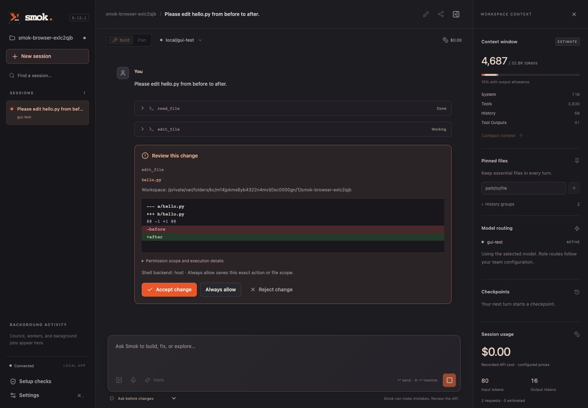

<p align="center"></p>
<h1 align="center">Smok</h1>
<p align="center"><strong>A small dragon for your code.</strong><br>Local models and hosted APIs. One coding loop.</p>
<p align="center">
  <a href="https://github.com/Mpawlowski5467/smok/actions/workflows/checks.yml"></a>
  
  
</p>
<p align="center"><a href="#quick-start">Quick start</a> · <a href="#capabilities">Capabilities</a> · <a href="#model-evaluation-results">Model results</a> · <a href="docs/README.md">Documentation</a></p>

Smok (Polish for “dragon”) is a local-first, model-agnostic coding harness. It gives
a tool-capable model a workspace, an inspect–edit–check loop, reviewable permissions,
and persistent context. Use the streaming terminal, a local browser app, or the
Tauri desktop app; all three share the same Python agent core.

**Development preview: 0.12.2.** Smok implements the original six-phase plan and
six further evaluation and reliability milestones. The code has automated regression
coverage and local model measurements. Model-generated repairs can still be wrong
or incomplete; the [results below](#model-evaluation-results) include those failures.



*The browser interface, captured with a deterministic test model. This demonstrates
the approval workflow; it is separate from the live model evaluations.*

## Capabilities

| Capability | What Smok provides |
| --- | --- |
| **Code inspection and editing** | Numbered file reads, ripgrep search, Python/JS/TS repository maps, exact replacements or whole-file writes, and LSP diagnostics, definitions, and references. |
| **Reviewable execution** | Plan/build modes, per-action approvals, scoped `AGENTS.md`, stale-read checks, unified diffs, recorded command results, and a self-review before completion. |
| **Recovery** | Shadow Git checkpoints, conflict-aware undo, persisted sessions, resume, and retention of partial work when a turn stops. |
| **Context and budgets** | File pins, context inspection, structured compaction, editable handoffs, token/cost accounting, and request, turn, and time limits. |
| **Model controls** | Anthropic and OpenAI-compatible adapters, configurable endpoints, prompt/tool/edit presets, optional reasoning and sampling controls, and explicit profile export. |
| **Extensions** | MCP stdio/HTTP servers, skills, Markdown commands, recipes, approved hooks, web fetching/search, and Playwright MCP integration. |
| **Team workflows** | Role routing, workers, councils in isolated worktrees, explicit candidate acceptance, background processes, and an optional SSH/Docker runner. |
| **Interfaces** | Streaming CLI/JSONL, React browser UI, Tauri desktop wrapper, session/context panels, setup diagnostics, image input, and optional browser dictation. |
| **Evaluation** | 34 tasks across the Phase 7/10/11/12 suites, independent graders, final-file verification, bounded runs, paired comparisons, and recorded failures. |

See [architecture](docs/architecture.md), [extensions](docs/extensions.md),
[teamwork](docs/teamwork.md), and [GUI](docs/gui.md) for behavior and integration limits.

## Quick start

Requires **Python 3.12+, [uv](https://docs.astral.sh/uv/), Git, ripgrep (`rg`)**, and
a running tool-capable model endpoint. The `lsp` extra adds the Python language server.
Node is needed for frontend development or rebuilding assets, not for using the
bundled browser interface. Native builds additionally require Rust and platform tools.

```sh
git clone https://github.com/Mpawlowski5467/smok.git
cd smok
uv sync --locked --dev --extra lsp

# Replace YOUR_INSTALLED_MODEL with an exact name from your endpoint.
uv run smok --doctor --model ollama/YOUR_INSTALLED_MODEL
uv run smok --gui --model ollama/YOUR_INSTALLED_MODEL

# Or use the terminal in a project you want to work on:
uv run smok -C /absolute/path/to/project --model ollama/YOUR_INSTALLED_MODEL
```

For Ollama, use `ollama list` to find an installed model. Smok does not download
models. `--doctor` performs local checks without generation; add `--probe-model`
to check the endpoint's model catalog. Catalog discovery does not prove tool support.

Start in **Plan** with “Inspect this project and explain its entry points.” Switch
to **Build** for a small change and review each proposed diff and check command.
The default permission mode asks before writes, shell commands, and server startup.

| Terminal command | Purpose |
| --- | --- |
| `/mode plan`, `/mode build` | Inspect or implement; Plan removes mutating built-in tools. |
| `/model provider/model` | Change the model while keeping history. |
| `/context`, `/context pin path/to/file` | Inspect context or keep a file's current contents available. |
| `/compact`, `/handoff` | Reduce active history or prepare a fresh session. |
| `/sessions`, `/usage` | Inspect saved work and accounted usage. |
| `/review`, `/undo` | Review current changes or restore the last changed turn. |
| `/help` | List commands. |

Resume with `uv run smok -C /path/to/project --continue`. For one task, use
`-p "your task"`; it emits JSONL by default. New approval requests are denied in
noninteractive mode unless the chosen policy or a saved rule already permits them.
See the [CLI reference](docs/cli.md) for permissions, exit codes, budgets, and sessions.

### Connect a model

| Selector | Adapter / default route | Credential |
| --- | --- | --- |
| `ollama/MODEL` | OpenAI-compatible, `127.0.0.1:11434/v1` | Optional `OLLAMA_API_KEY` |
| `local/MODEL` | OpenAI-compatible, `127.0.0.1:1234/v1` | Optional `SMOK_API_KEY` |
| `anthropic/MODEL` | Anthropic Messages | `ANTHROPIC_API_KEY` |
| `openai/MODEL` | OpenAI Chat Completions | `OPENAI_API_KEY` |
| `gemini/MODEL` | Gemini's OpenAI-compatible route | `GEMINI_API_KEY` |
| `openrouter/MODEL` | OpenRouter | `OPENROUTER_API_KEY` |

Use a model ID available at your endpoint. Keys come from environment variables or
the GUI's local key settings; `.env` files are not loaded automatically.
`--base-url` and `--config models.yaml` support endpoint/profile overrides.

The live measurements here use local models through Ollama. Hosted adapters have
protocol tests, but live Anthropic/OpenAI/Gemini/OpenRouter quality, billing, and
vision validation remain open. Implemented routes are not a guarantee that every
model or endpoint supports every tool or reasoning option.

An explicit Gemma repair profile is available:

```sh
uv run smok --model ollama/gemma4:26b \
  --config examples/models/phase12-parser-gemma-context.yaml
```

This is the **64K working-context profile** tested on the known command-parser
regression: lean guidance, minimal tools, no thinking, temperature 1.0, and top-p 0.95.
It is **not a universal recommendation**. It excludes search, LSP, extensions, and
team tools. Neither qualification nor profile export silently changes your default
model. See the [protocol and results](docs/phase12-parser-resolution.md).

## Model evaluation results

These are **small, original local development evaluations**, not SWE-bench or
Terminal-Bench scores. Results belong to their recorded harness version, fixtures,
settings, and limits; historical scores are not measurements of every later revision.
The development host was Apple Silicon macOS with Python 3.12.

A **complete pass** requires independent correctness, allowed edit scope, and a
completed agent turn. Phase 10–12 also require the prescribed project test command
to pass on the **final source bytes**. Correct code at a timeout or without a final
check remains a failed attempt.

| Experiment | Model / controls | Complete passes | What the sample showed |
| --- | --- | ---: | --- |
| Phase 7 tuning, 15 tasks × 1 repeat | Qwen3.6 27B MLX: default → lean/coding | **11/15 → 13/15** | Fewer completion failures; the candidate also had a correctness regression. |
| Phase 7 held-out sample, 5 tasks × 1 repeat | Same two profiles | **4/5 → 4/5** | Both timed out on dependency ordering despite correct final code. |
| Phase 10 project workflows, 6 tasks × 1 repeat | Qwen3.6 27B MLX, default | **4/6** | CLI-port validation and manifest completion needed follow-up. |
| Phase 11 qualification, 4 tasks × 2 repeats | Qwen3.6 27B MLX: default → no thinking | **2/8 → 5/8** | Three paired gains, no paired pass regression; release selection still failed. |
| Phase 12 fresh-project comparison, 4 tasks × 2 repeats | Qwen3.6 27B MLX / Gemma4 26B, both focused repair | **4/8 / 1/8** | Audited scores; input validation and command parsing remained unreliable. |

Phase 7 used a 180-second task limit and 12 calls; Phase 10–12 used 300 seconds and
16 calls. The rows are separate experiments, not a pooled leaderboard. The Phase 12
audit corrected a false Qwen event-replay pass from the original **5/8** report.
Its comparison verdict remains **tradeoff**, with too few shared passes for the
predeclared latency selection rule.

Later known-regression checks are encouraging but narrower:

- Qwen's no-thinking profile passed **3/3 CLI-port** and **3/3 manifest** repairs.
- Gemma's focused-repair profile passed **3/3 release-selection** and **3/3 table-join**
  repairs in separate fixed validations with strengthened public tests.
- Phase 12 Gemma validation passed **2/2 renames** and **2/2 event replays**; byte ranges
  were **0/2**. A subsequent whole-file pilot passed one byte-range case but failed
  its parser case during compaction.
- The latest **0.12.2 Gemma parser validation passed 3/3**, in **88–99 seconds** with
  13–14 calls, using the explicit **64K working-context profile** above. Output,
  request, and turn limits stayed at 4,096 tokens, 16 calls, and 300 seconds.
  The same runtime with 32K context passed **1/3**. All failed pilots remain recorded;
  this known regression is not fresh-project qualification or a guarantee of reliability.

Version 0.12.2 adds explicit sampling controls, a remaining-call hint, fresh-read
guidance after compaction, and one bounded retry after a truncated task response.
It skips compaction that cannot shrink history and keeps recent check evidence first
in review. Permissions, stale-read checks, final review, and budget enforcement remain
in place. The larger working context is an opt-in profile, not a changed global default.

Read the [model results and methodology](docs/model-results.md),
[Phase 12 contract audit](docs/phase12-contract-audit.md), and
[parser recovery results](docs/phase12-parser-resolution.md). Compact plans/results and hashes are
committed under `docs/`. Full local model traces, generated workspaces, and frozen
archives stay in ignored `evals/results/`; they are not included in this repository.

## Checks and development

The current Python regression suite passes **614 tests**. CI runs deterministic
Python checks, the frontend build, browser scenarios, and wheel/source verification;
it does not spend a live model API budget. See [validation](docs/validation.md) for
dated results, exact scope, and remaining checks.

```sh
uv run pytest
uv run ruff check .
uv run ruff format --check .

npm ci --prefix web
npm --prefix web run build
npm --prefix web test

uv build
uv run python scripts/check_release.py
```

Browser tests require Chrome/Chromium. See [contributing](CONTRIBUTING.md) for browser
setup, local development, packaging, and how to add or run evaluations. macOS native
build instructions and verification are in the [GUI guide](docs/gui.md#development-and-checks).
Native runtime validation currently covers Apple Silicon; public installers are not
signed/notarized releases.

## Permissions and data

Smok stores sessions, tool outputs, checkpoints, and local settings under `.smok/`
in each workspace. Add that directory to your project's ignore file. GUI-saved keys
are owner-only local files, **not encrypted keychain entries**. Model requests go to
the selected provider; using a hosted model sends the selected context to that service.

Approvals and path checks are not operating-system isolation. The default shell runs
as your user. An optional Docker backend isolates shell commands only; model HTTP
calls, language servers, and MCP processes still run on the host. Plan mode restricts
tools, and checkpoints restore eligible workspace files, not external side effects.
See [execution boundaries](docs/cli.md#project-settings-and-shell-execution).

## Documentation and project status

Start at the [documentation index](docs/README.md). It links setup, troubleshooting,
CLI/configuration, GUI, extensions, teamwork, architecture, all evaluation protocols,
and the [roadmap](docs/roadmap.md).

The immediate next work is fresh-task qualification after tuning, repeated byte-range
validation on the current runtime, and broader platform/provider validation.
The source and dragon artwork do not yet have a selected open-source license.
`smok-harness` is the Python distribution name and `smok` is the command; this source
publication does not publish a package or a signed desktop release.
