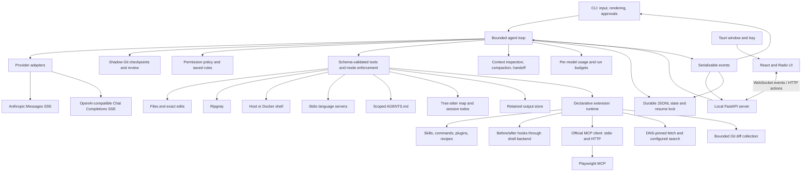

# Architecture

## Project workflow evidence (0.10)

The separate Phase 10 suite adds multi-file repairs with immutable public tests and
independent graders. Its required shell commands are explicit in both the prompt and
approval policy. `evals.evidence.AttemptEvidence` records request/tool durations and
the file snapshots around each required command. The latest command must succeed
without changing that snapshot, and its hashes must match the final workspace.
Timing remains evaluation-side observation; the core event protocol is unchanged.
See [project workflow reliability](project-workflows.md).

## Setup and release checks (0.9)

`diagnostics` supplies the same report to `smok --doctor` and the authenticated
`POST /api/diagnostics` GUI route. Local checks read configuration through
`Configuration(load_keys=False)`, preserving process environment and workspace state.
Explicit model discovery uses a bounded GET against the configured endpoint, with
redirects disabled and response/error content excluded from reports. Catalog results
remain separate from generation and tool-support verification.

The standalone `check_release.py` verifies version alignment and archive/source
parity; `check_desktop.py` exercises the bundled server in a disposable workspace.
Neither publishes artifacts. See [setup and local release checks](setup.md).

## Model tuning and evaluations (0.7)

`smok.tuning` defines lean/full prompt guidance, tool-set presets, and edit formats.
The registry resolves its active model configuration on every schema/prepare/execute
operation, so model routing cannot leave a stale tool policy. Model sets intersect
with Plan mode and worker restrictions. Exact edits restrict existing-file writes;
full-file profiles omit edit_file. Cost/context previews use the requested candidate's
prompt and schemas without changing the running agent.

The repository-local `evals` package loads validated fixtures and separate graders.
It runs profile/model matrices against fresh Git workspaces using the normal Agent,
Journal, Checkpoints, and shared RunBudget. Bounded isolated grader processes verify
behavior and a scope check detects unrelated changes. JSONL evidence, provider/estimate
usage, source/task/profile fingerprints, repeats, and paired outcomes feed atomic
JSON/Markdown reports. CI tests the graders against broken seeds and reference repairs;
live model runs stay explicit. See [evaluation and tuning](evaluation.md).

`smok` is the core; `smok.cli` and `smok.gui` are its terminal and local web clients.
The core has no Rich, prompt-toolkit, print, or input calls. FastAPI serializes the
same events and supplies an asynchronous approval callback; React renders the UI.
The Tauri host launches a bundled server and gives its native window the private launch link.

## Conversation and streaming

`types.py` defines text, validated image, tool-call, and tool-result blocks. Arguments remain raw JSON
until schema validation so malformed calls can receive useful errors. Adapters emit
`text_delta`, `tool_call`, `usage`, and `stop`. The loop buffers tool fragments until
a complete response and withholds execution after stream failure or output truncation.

Each call gets one matching result slot before approval/execution begins, preserving
valid history on cancellation. Models can be switched between turns using shared
text/tool/image history. Images require an explicitly vision-enabled profile.
Signed thinking and provider-specific state are not portable. Checkpoint worker operations run off the event loop; cancellation waits for
the worker before releasing the workspace lock or finishing the snapshot.

## Tool execution

The registry validates schemas and plan/build mode before preparing any action, then
checks mode and approval again at execution. File writes check read hashes and scoped
instructions both before and after the approval wait. Atomic replacement preserves
file permissions and refuses stale contents. Exact edits count overlapping matches
as ambiguous. Ranged reads and writes allow UTF-8 files up to 16 MiB; outputs are bounded.
The registry retains long results and errors before returning a 12,000-character
preview and opaque output ID. `read_output` exposes a paginated archive capability,
without granting general `.smok` file access. Capture/storage limits remain explicit.

`PermissionPolicy` supports ask, auto-edit, and full-auto plus persistent rules.
Remembered file grants are literal paths, commands are literal shell strings, and
server grants are argv lists. Explicit command patterns compare a complete token
sequence and refuse shell operators/substitution. Settings and journals reject
symlinked metadata paths. These are capability checks, not host OS isolation.

Plan mode filters mutation tools out of schemas and rejects guessed or previously
prepared mutation calls. LSP requests are read-only, but the approved server process
runs on the host and can have its own effects. The client rejects `workspace/applyEdit`.
Root and visited nested AGENTS.md files enter the system prompt with scope labels;
new/changed scoped guidance must be read before file edits.

## Checkpoints and self-check

`Checkpoints` uses a separate bare Git repository, index, and commit chain under
`.smok/checkpoints/`. It hashes workspace bytes directly, bypassing filters and hooks,
and never alters the real repository's HEAD/index. Repository ignore rules apply to
untracked files; global/system Git configuration is disabled for checkpoint commands.
Previously captured files remain tracked by the snapshot if ignore rules change.

A lock excludes overlapping Smok turns. Before/after manifests record contents,
symlinks, and full file modes. Undo preflights all changed paths before restoring any,
and attempts rollback if restoration fails. It refuses later conflicting changes,
symlink-parent redirects, and hard-crash turns without an end boundary. Limits and
scope exclusions are documented in the README; this is not a whole-machine rollback.

After mutations and before the next model request, the core supplies actual snapshot
diffs, a bounded copy of the current user request, and recorded command outcomes.
The request remains available to review after history dropping or compaction. Full
and lean prompts share guidance to check constraints across affected entry points
and input sources, and to avoid todo bookkeeping for small repairs.
Further changes trigger another review; unchanged
signatures are deduplicated and iterations remain bounded. A final-response check also
detects edits made during generation; in that case another review can follow streamed
text. `turn_finished` is held until review and final checkpoint finish.
Without checkpoints, the fallback reviews only file-tool diffs. Review is model-based,
not independent verification. Deterministic eval checks remain separate.

Successful atomic writes retain the hash of their supplied contents as observed
file state. This allows consecutive edits without a redundant read while preserving
the current-bytes comparison at preparation and approval time. Hooks clear observed
hashes, as do context resets and session resume. Eval runs reuse the same enforced
`allowed_tools` intersection as workers, exposing only capabilities their approval
callback can authorize; profile presets cannot widen that restriction.

`reliability.within_deadline` applies a monotonic turn deadline while requesting events
from the core iterator. No timeout context remains active while a client renders a
yielded event. The outer routed turn owns one deadline across escalation and shadow
work. Expiry closes the source iterator and completes cancellation/checkpoint cleanup
before recording a `time_limit` outcome. Exact denied-action identities are retained
within a turn before consulting approval policy. See [reliability](reliability.md).

In 0.10, the iterator also scopes the active deadline through a context variable while
requesting each event. Nested routed work inherits the earliest deadline. Model system
context includes a fresh remaining-time hint in the runtime section, outside the stable
Anthropic cache block; the context variable is restored before
yielding to clients and is not serialized into session history. The hint changes no
approval, timer, or completion rule.

## Processes and LSP

`process.capture` drains bounded output, applies timeouts, and kills the process group
on completion or cancellation. The host shell uses `/bin/sh -c`. Docker shell commands
use an argv-based `docker run`, no automatic image pull, no network by default, a
workspace bind mount, protected metadata overlays, restricted privileges/resources,
and forced container removal during cleanup. Failure never falls back to the host.

The LSP client implements bounded Content-Length frames, request IDs/timeouts,
configuration requests, full-text document synchronization, save notifications when
requested, and diagnostics/definition/reference requests. Input positions convert
Unicode character offsets to UTF-16. Versioned stale diagnostics are discarded;
unversioned reports are explicitly marked `version_verified: false`. Server disconnects
fail outstanding requests. Missing diagnostics are not treated as an error-free file.
Language servers are reused per configuration and shut down with the client.

## Event contract

Events are `{"type": "...", "data": {...}}`; journals add UTC timestamps and begin
with `session_started` and `schema_version: 2`. Current events include:

| Event | Purpose |
| --- | --- |
| `turn_started`, `model_started` | Prompt, mode, selected model, and iteration |
| `text_delta`, `usage` | Visible text and provider usage or reserved estimates |
| `tool_call`, `tool_result` | Call arguments, bounded result, and error flag |
| `diff` | Proposed file change, including automatically approved edits |
| `permission_requested`, `permission_resolved` | Displayed request and decision/source |
| `checkpoint_created`, `checkpoint_finished` | Turn snapshot ID and changed paths |
| `checkpoint_restored` | Successful undo and affected paths |
| `self_check_started` | Changed paths and recorded command outcomes |
| `mode_changed`, `permissions_changed` | Client-selected mode/policy |
| `context_usage`, `context_report` | Preflight count/source and estimated component shares |
| `compaction_started`, `compaction_finished`, `compaction_skipped` | Compaction and reduction evidence |
| `todos_updated`, `handoff_created`, `session_list` | Planning state, exported path, saved sessions |
| `cost_preview`, `usage_report`, `budget_exhausted` | Configured-price estimates, totals, and limits |
| `extension_report` | Catalog, server listing, or explicit connection result |
| `recipe_step_started`, `recipe_step_finished`, `recipe_stopped` | Workflow progress and stop boundary |
| `session_state`, `session_resumed` | Journal-only durable state and recovery boundary |
| `turn_time_limit` | Deadline explanation after partial-work and usage cleanup |
| `error`, `turn_finished` | Failure detail; complete, time_limit, iteration_limit, budget_limit, or error |

The core interface is an in-process async iterator. The GUI service owns turn tasks
independently of a browser connection, subscribes to both iterator and team events,
and assigns random approval IDs. Reconnecting clients get a snapshot and pending
requests. Bounded queues resynchronize slow clients. CLI journals can be watched
without acquiring their exclusive writer lock. Network events include `snapshot`,
`metadata`, `approval_pending`, `approval_closed`, `idle`, and `history_restored`.

The server binds only 127.0.0.1. A per-launch fragment token bootstraps an HttpOnly,
SameSite cookie. Host and Origin checks apply to HTTP/WebSocket requests; there is
no wildcard CORS, external script loading, or native shell/file IPC grant. Read-only
share capabilities expose frozen, reviewed text projections, never live session APIs.
Configuration edits validate before writing and reject stale browser revisions.

Images are decoded and format/dimension/size checked before entering history.
Adapters emit native base64 image blocks; local estimates account for pixels rather
than base64 prose. Text compaction, oracle handoffs, and replay omit image bytes with
an explicit marker. Read-only shadow runs are skipped for new image input. PNG/JPEG/
WebP data is retained in the private journal; it is excluded from share projections.

## Extension boundary

`extensions.catalog` discovers bounded declarative files under `.smok-extensions`.
It rejects redirected paths, invalid metadata, duplicate names, and reserved commands.
Plugins namespace their contributions; skills expose metadata until explicitly loaded.
`extensions.runtime` owns the catalog, MCP connections, and web settings. Reload builds
a validated set before disconnecting the previous one; failed validation preserves
the old set. No extension Python module is imported into the agent process.

The registry prepares the action and matching hooks together. An exact approval
fingerprint binds arguments, hook commands, backend, and relevant MCP configuration/
schema. File-only approval cannot authorize a newly discovered hook. Hooks receive
bounded JSON on stdin and run through the selected shell backend; after-hook errors
preserve the original action outcome. Plan mode suspends hooks and enforces a local
MCP read-only list independently of server annotations. File-read hashes are cleared
after hooks because they can change arbitrary files.

MCP uses the official SDK in an owning task for each persistent connection. The client
does not enable server-requested sampling, elicitation, automatic OAuth, or automatic
action retries. Disconnects/timeouts require explicit reconnection. Supported media
is saved as bounded artifacts; text and structured data use normal output retention.
The host/remote MCP trust boundary is separate from Docker shell isolation.

Web connections use a custom `httpcore` network backend: resolve once, validate all
addresses, connect to a numeric address, retain the original hostname for TLS. Redirects,
timeouts, content types, and body sizes are bounded; search headers never follow a
redirect. HTML extraction runs no JavaScript. Browser automation comes through MCP.

`extensions.workflows` composes ordinary `Agent.run` streams for commands, recipes,
and reviews. Recipes stop on tool errors/denials and share run budgets. Review uses
plan mode and restores the previous mode on completion or cancellation. The diff
collector disables Git external drivers/textconv, excludes metadata, and handles
staged/unstaged/untracked and merge-base branch scopes. It collects evidence; defect
identification and severity remain model judgments. See [extensions](extensions.md).

## Context, persistence, and budgets

`Context` partitions history at complete tool exchanges. Pins are fresh file content;
the repo map and todo list are separate system context. The context X-ray reports
system, schema, history, tool output, summary, map, pin, and todo shares. Compaction
uses a separate tool-free model request and validates a bounded structured summary
before committing it. Failed, truncated, nonreducing, or tool-bearing summaries leave
history intact. Already compacted prefixes alone are never repeatedly summarized.
Large histories can be folded incrementally after switching to a smaller working limit.
Handoff folds a copy of history and exports editable JSON without replacing the session.

The journal saves state before action execution, after each tool result, after model
usage accounting, and at turn boundaries. Tool-result placeholders make interrupted
snapshots serializable in both provider formats. Resume never replays calls, restores
read hashes, or imports approval grants. `flock` prevents concurrent use of a session;
fsynced state boundaries and partial-tail recovery handle interrupted writes. Records
and complete files have read/write size limits, and metadata symlinks are rejected.

Usage accounting separates provider-reported totals from estimates and tracks each
model across switches. Anthropic input totals include uncached, cache-read, and
cache-creation tokens exactly once. Budget preflight reserves estimated input and the
output allowance; missing final usage reserves the same amount. Compaction, handoff,
and review all use this request path and its call/token/dollar limits. Per-invocation
budgets remain separate from persisted session totals. Dollar amounts require current
explicit prices; local inference is zero API cost. Preflight is not a billing guarantee.

## Protocol references

HTTP transport uses `httpx` and a small SSE parser. API keys are resolved from the
environment at request time. OpenAI uses `max_completion_tokens`; other compatible
routes default to `max_tokens`. Anthropic cumulative usage is emitted once per request.

- [OpenAI Chat Completions](https://developers.openai.com/api/reference/resources/chat/subresources/completions/methods/create)
- [OpenAI function calling](https://developers.openai.com/api/docs/guides/function-calling)
- [Anthropic streaming](https://platform.claude.com/docs/en/build-with-claude/streaming)
- [Anthropic token counting](https://platform.claude.com/docs/en/build-with-claude/token-counting)
- [Anthropic prompt caching](https://platform.claude.com/docs/en/build-with-claude/prompt-caching)
- [Python Tree-sitter bindings](https://github.com/tree-sitter/py-tree-sitter)
- [Ollama OpenAI compatibility](https://docs.ollama.com/api/openai-compatibility)
- [Language Server Protocol 3.17](https://microsoft.github.io/language-server-protocol/specifications/lsp/3.17/specification/)
- [Docker run options](https://docs.docker.com/reference/cli/docker/container/run/)
- [Official MCP Python SDK](https://github.com/modelcontextprotocol/python-sdk)
- [Playwright MCP](https://github.com/microsoft/playwright-mcp)
- [Brave Search API](https://api-dashboard.search.brave.com/api-reference/web/search/post)

Provider fixtures are synthetic protocol examples, not recordings of live frontier
requests. The optional Python LSP integration test runs a real installed server.

## Teamwork

`team.coordinator.Team` wraps ordinary user turns and attaches the delegate/oracle/
remote tools. It selects mode/role profiles and creates restricted child registries
without nested delegation or executable extensions. Each child has fresh messages,
read grants, output storage, and optional journal. Only bounded summaries/artifact
references enter the parent tool result. Child progress, proposed diffs, and approval
requests flow through the coordinator's event callback; full child exchanges remain
in their journals. Clients should attach that callback alongside consuming `Agent.run`.

`RunBudget.reserve` books token/cost allowances without an intervening await; settlement
removes the reservation and records actual or conservative estimated usage. Every role
shares that budget and a request cap. Child usage also records into the parent session
ledger. A child cannot reset the parent budget or grant itself tools. Approval callbacks
are serialized, and denial prevents automatic escalation.

`team.worktrees` captures private snapshot commits with a temporary index, pins them
under `refs/smok/snapshots`, and creates detached worktrees for independent edits.
The main HEAD/index remain unchanged. Git hooks/filters are disabled for capture and
checkout. `team.lab` validates council candidates, constrains judge selection to eligible
results, accepts explicitly reviewed patches with baseline/conflict checks, and replays
recorded user tasks from initial snapshots. Retained reports expose interrupted runs.

`team.jobs` drains background process output into bounded rings and owns process-group/
container cleanup. `team.remote` sends a validated snapshot and bounded allocation over
SSH to a disposable Docker-shell worker; the response is data and a patch, never an
instruction to apply changes. Unknown remote usage retains the allocated charge.

New events include `task_started`, `replay_snapshot`, `model_routed`, `escalation`,
`worker_started`, `worker_finished`, `shadow_started`, `shadow_finished`, `council_started`,
`council_finished`, `replay_started`, `replay_finished`, `candidate_accepted`, and
`team_report`. Internal attempts are labeled in `turn_started`; only user tasks feed
replay. See [teamwork](teamwork.md) for exact limits and protocol behavior.
