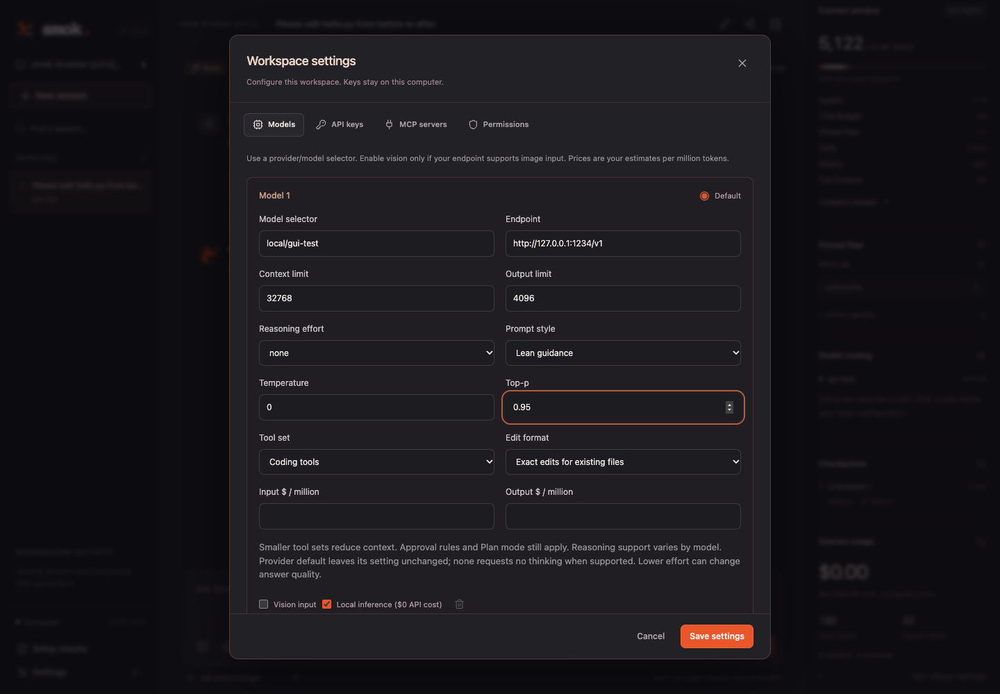

# Evaluation and model tuning

Smok 0.7 adds an evaluation milestone agreed after the original six-phase plan.
It makes prompt, tool, and edit-format experiments measurable while preserving the
existing default profile. It does not automatically rewrite workspace preferences.



## Model controls

Model YAML profiles and **Settings → Models** accept these controls:

| Field | Choices | Behavior |
| --- | --- | --- |
| `prompt_style` | `full` (default), `lean` | Select full guidance or a shorter prompt retaining instruction boundaries, denial handling, and evidence requirements. |
| `tool_set` | `full` (default), `coding`, `minimal` | Choose the tools advertised to the model and accepted by the core. |
| `edit_format` | `both` (default), `exact`, `whole_file` | Offer both edit tools, require exact replacements for existing files, or use full-file writes. |
| `reasoning_effort` | `null` (provider default), `none`, `minimal`, `low`, `medium`, `high`, `xhigh`, `max`, `ultra` | Explicit thinking control for compatible endpoints; actual supported values depend on the model. Added in 0.10.1. |
| `temperature` | `null` (omit), number from 0 to 2 | Explicit sampling temperature for compatible endpoints. Added in 0.12.2. |
| `top_p` | `null` (omit), number from 0 to 1 | Explicit nucleus sampling for compatible endpoints. Added in 0.12.2. |

`minimal` includes read_file, list_dir, read_output, write_file, edit_file, and
run_shell. `coding` adds grep, glob, repo_map, write_todos, and the three LSP tools.
`full` includes available extensions, MCP tools, and team/process tools. Existing
Plan mode and worker tool restrictions intersect with the selected set.

In `exact` mode, write_file creates new files only; existing files use edit_file.
In `whole_file` mode, edit_file is unavailable. Every write still requires a current
read hash, applicable project instructions, and permission. Prepared calls are checked
again after approval, including if the model profile changed. These are file-tool
formats, not a sandbox for separately approved shell commands or human workflow actions.

The context/cost preview uses each candidate's prompt and tool schemas. Routing and
mid-session model switches apply the selected profile immediately. CLI session state
retains these settings; the GUI uses the current saved workspace model profile.

Example, saved as an optional model configuration:

```yaml
models:
  ollama/qwen3.6:27b-mlx:
    prompt_style: lean
    tool_set: coding
    edit_format: both
```

Use `smok --config /path/to/models.yaml --model ollama/qwen3.6:27b-mlx`,
or select the same fields in Settings.
The repository includes an opt-in [lean coding example](../examples/models/lean-coding.yaml).
A smaller profile can exclude capabilities needed by a task; choose full when those
capabilities matter. The installed local model name is specific to this machine.

## Twenty independent tasks

Phase 11 adds a [four-project qualification suite](model-qualification.md) and an
offline comparison/profile-export tool. It keeps tuning and holdout evidence separate,
requires matched plans, and excludes failed tasks from successful-task latency comparisons.

Phase 10 adds a separate [six-project workflow suite](project-workflows.md), selected
with `--suite phase10`. It requires actual project tests against the final files and
an explicit shell opt-in. The Phase 7 default and its original split remain unchanged.

Run the evaluation commands from a Smok source checkout.

The Phase 7 suite contains **15 tuning tasks and five holdout tasks**. They cover
single-file fixes, normalization, CSV/JSON handling, algorithms, exception behavior,
multi-file API/import repairs, timezones, caching, and pagination.

```sh
uv run python evals/run.py --list --split all
```

Every task has a fresh temporary Git fixture, explicit allowed file changes, and a
separate grader under `evals/checks/`. Graders never enter the model's workspace or
conversation. CI verifies that every broken seed fails and every reference solution
passes. Check processes use isolated imports, fresh bytecode-cache locations, bounded
output, a ten-second timeout, and process-group cleanup. An end marker rejects an
early `exit(0)` as a false pass.

The 0.8.1 interval fixture explicitly defines touching as a shared endpoint on the
number line and checks that every positive gap stays separate. This strengthened
prompt/grader has a new task fingerprint. Earlier reports retain their original
outcomes; [follow-up validation](validation.md#stronger-interval-grading) records
offline rescoring of the saved repairs and separate fresh attempts.

Generated Python still runs on the host. Temporary directories and separate graders
are not an adversarial OS sandbox. Use trusted local models or a separately isolated
machine for higher-risk evaluation. Phase 7 grants file edits only within each task's
scope; shell and language-server approvals remain separate opt-ins.

A task passes only when the independent check passes, changes stay in scope, and
the agent completed its turn. Legacy Phase 2 tasks additionally require their specified
tool calls and undo check. A repair that passes its check after exhausting a call cap
is reported as `check_passed`, but is not counted as a completed pass.

## Run a controlled comparison

```sh
# Compare one prompt axis on tuning tasks. No model is downloaded.
uv run python evals/run.py --model ollama/qwen3.6:27b-mlx \
  --variant baseline --variant lean --allow-tools

# Compare the combined lean-prompt/coding-tool candidate.
uv run python evals/run.py --model ollama/qwen3.6:27b-mlx \
  --variant baseline --variant lean-coding --allow-tools \
  --max-requests 240 --budget-tokens 2000000 --task-timeout 180

# After choosing a candidate on tuning tasks, use the untouched holdout split.
uv run python evals/run.py --model ollama/qwen3.6:27b-mlx \
  --split holdout --variant baseline --variant lean-coding --allow-tools \
  --max-requests 240 --budget-tokens 2000000 --task-timeout 180
```

`baseline` preserves the supplied profile. `lean`, `coding`, `minimal`, `exact`,
and `whole-file` change one field each. `lean-coding` changes two fields together;
its result cannot identify which individual change caused an improvement. Repeat
`--model` to compare endpoints, or `--task` for a focused subset. `--repeats 3` runs
independent attempts; these are recorded individually, not as best-of-three success.

`no-thinking` sets only `reasoning_effort: "none"` and requires endpoint/model support.
It retains the supplied prompt, tools, and output limit; it never extends deadlines
or skips verification. Unsupported settings fail visibly. See the
[local reasoning-control guide](project-workflows.md#reasoning-control-for-the-local-model)
and the recorded quality/completion results before choosing this option.

`focused-repair` combines `prompt_style: lean`, `tool_set: minimal`, and explicit
`reasoning_effort: none`. It targets small repairs and does not expose todo/search/LSP
or extension tools. Its [release/join evaluation](repair-reliability.md) uses known
regressions with expanded public coverage, not fresh qualification tasks. The variant
does not alter permissions, output limits, deadlines, or self-review.

Select tasks explicitly for the edit-format comparison, for example
`--task fix-addition --task rename-public-api --variant baseline --variant exact
--variant whole-file`. Task prompts and graders stay fixed across variants. Variant
order alternates deterministically across tasks/repeats to reduce order bias.

The default split is `tune`. Holdout outcomes are reported separately and should not
be used to adjust a candidate repeatedly. These are small original smoke fixtures,
not SWE-bench or Terminal-Bench scores. One local model and one repetition do not
establish general model superiority or statistically reliable timing differences.

In Smok 0.8, `--task-timeout` sets the core turn deadline. An additional ten seconds
allow cleanup and reporting before the eval's outer safety timeout. A core `time_limit`
outcome remains a failed completion even if the independent code check passes.

From 0.8.1, fixture runs advertise only authorizable built-in tools. Shell and LSP
tools are omitted unless their respective opt-in flags are set; execution guards
still reject guessed calls, and declared file scopes and exact shell-command lists
still apply. The model receives these execution constraints before its first request,
without grader code or reference solutions. Verification that cannot run must be
reported as unrun. Extensions, hooks, MCP, and background processes are unavailable
in these fixtures.

This runtime restriction intersects each model profile. In a fixture, `full` and
`coding` can expose the same effective tools; compare the recorded `available_tools`
before attributing differences to a preset. Historical runs before 0.8.1 exposed
tools that the runner would subsequently deny, so cross-version comparisons measure
that workflow change as well as core changes.

## Reports, budgets, and replay

Each run writes `evals/results/<timestamp>-<suite>/report.json` and a readable
`report.md`, updated atomically after every case. Attempt folders retain JSONL events,
full session state, bounded generated files, and independent check output. Raw runs
remain Git-ignored. Reports record:

- Model/profile configuration, source and task fingerprints, split, repeat, and order.
- Allowed tools for the run and effective tools per attempt after profile restrictions.
- Completed passes, check-only passes, stop reason, scope violations, tool errors,
  successful tools, denials, and self-check count.
- Turns, model requests, context samples, provider/estimated token counts, cache usage,
  known API cost, unpriced requests, and elapsed time.
- From 0.10, observed model/tool durations (including interrupted requests), event
  timestamps, and required project checks matched to the final file snapshot.
- Paired wins/regressions and token changes against the same model/task/repeat baseline.

A report's `complete` status means the planned matrix finished, including any failed
cases. The command exits successfully only when every case passed; a timeout or
failed check remains a failed attempt even if the rest of the matrix completes.

Unknown prices stay marked as incomplete; local API cost is $0 and excludes hardware
and electricity. All task requests, compaction, and review calls share the run's
`--max-requests`, `--budget-tokens`, and optional `--budget-usd` limits. The dollar
limit requires configured model/cache prices. Per-task deadlines and call limits
remain active as well. Provider keys come from the selected profile's environment
variable, and values are never stored in report configuration.

Interrupted runs preserve completed cases and consumed budget. Resume with the same
selection, profiles, source, and limit flags plus `--resume /absolute/run/directory`.
Completed cases are skipped; an interrupted attempt is preserved and rerun in a new
fixture. The runner rejects incompatible resume conditions. It does not retry failed
completed cases silently. Start a new run to measure a changed implementation.

```sh
# Compare existing reports without contacting any provider.
uv run python evals/run.py --compare \
  evals/results/RUN_A/report.json evals/results/RUN_B/report.json
```

Comparisons reject changed task fingerprints. Source revisions and run completion
states remain visible; compare equal task sets and repeats before drawing conclusions.
Fingerprints identify harness code, tasks, and client configuration, not the provider's
model weights or server settings. Unset sampling fields use endpoint behavior, which
can differ from installed model metadata. For example, Ollama 0.40.4's compatibility
API supplies temperature and top-p 1.0 when omitted. Set `temperature` and `top_p`
explicitly in model YAML or Settings to record and send them; zero is retained and
null omits the field. These controls persist on CLI resume and in exported evaluation
profiles. Unsupported adapters/settings fail rather than silently dropping an override.
Neither explicit sampling controls nor a repeated command promise identical output.
See the [sampling audit](phase12-parser-resolution.md#sampling-audit).
For live results measured on this machine, see [validation](validation.md) and the
[compact results artifact](evaluation-results.json). In this single local trial,
lean-coding reduced accounted tokens by 32.8% on tuning and 17.6% on holdout. Both
profiles completed 4/5 held-out tasks, with correct code on all five; both timed out
on dependency ordering. The example remains an opt-in candidate, not a promoted default.

## Development checks

```sh
uv run pytest
uv run ruff check .
uv run ruff format --check .
npm --prefix web run build
npm --prefix web test
```

The ordinary Python test suite runs every grader against broken and repaired fixtures,
plus deterministic agent tests, without contacting a model provider. Paid/live model
runs stay explicit so routine CI does not spend an API budget.
