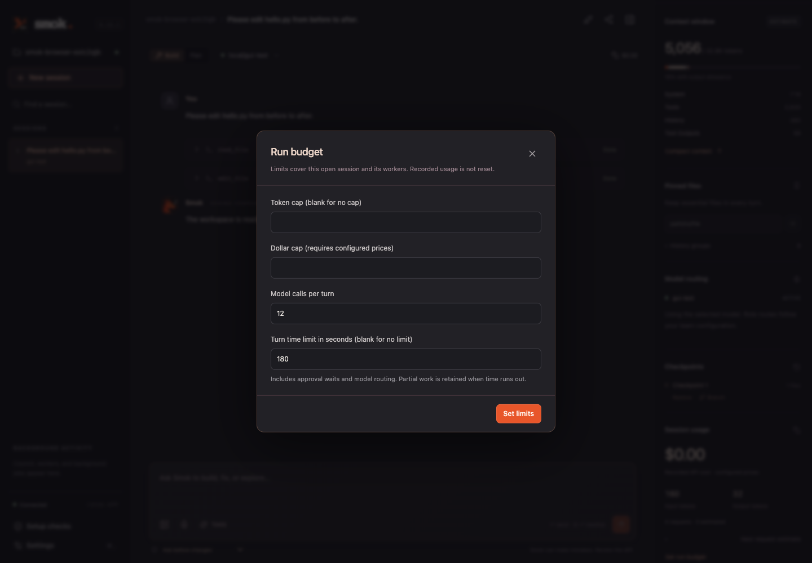

# Reliable completion and turn limits

Smok 0.8 addressed the completion overhead observed in Phase 7. Seven of the eight
timed-out attempts passed the available code checks and had entered a separate review
after drafting a final response. The changes keep review and approval boundaries
while avoiding that extra final-response cycle. Version 0.12.1 refines the sequence
for multi-file work, as described below.

## Review before finishing

After related edits reach a shell check, Smok supplies the actual current diff and
recorded command results before the next model response. Without an available shell
tool, it reviews immediately after changes. If the model skips checks and attempts
to finish, its draft completion is withheld from output and saved history until a
review runs. This can consume an additional request; it never extends the call cap.
The model can then fix problems or finish. Further changes receive another review;
an unchanged diff does not start another review cycle. Reads alone do not trigger
another workspace scan.
The final-response check also detects files changed while the model was responding.

Review is still model judgment. An independent test or eval grader supplies separate
correctness evidence. `--no-self-check` continues to disable the review mechanism.

From 0.11.1, a new review replaces the preceding automatic review prompt within the
current turn. The latest prompt still contains the cumulative diff, original request,
and all recorded commands. User messages and tool exchanges remain; review events
and journal snapshots retain prior evidence. Related edits can share one model
response so the full change is reviewed together.

Version 0.8.1 retains the content hash after Smok successfully writes a file. The
model already supplied those exact bytes, so it can make a follow-up edit without a
redundant reread. Both preparation and approval-time checks still compare current
bytes with the known version. External changes, hooks, context resets, and session
resume invalidate that knowledge; edits still require approval as before.

Reviews focus on concrete defects within the requested scope and available checks.
The eval runner now advertises only tools it can authorize and explicitly states
when shell/LSP verification is unavailable. Missing tools are enforced by the core,
not just omitted from the prompt. This avoids generating commands that the runner
would always deny. Runtime verification is still reported as unrun when unavailable;
independent grading remains outside the model context.

Version 0.10.1 includes a bounded copy of the current user request in each change
review, so its constraints stay visible even after history is dropped or compacted.
Both full and lean prompts ask the model to trace constraints through every affected
entry point and input source, including overrides and error paths. Passing the
available tests does not establish that untested requirements are implemented.

Small repairs now proceed directly through inspection, edits, and checks. Todo lists
remain available for substantial work, with updates at meaningful milestones.
Independent tool calls with known inputs can share a response; dependent operations
must wait for prerequisite results. Each call still follows its own permissions,
content guards, and error handling. A successful test or todo update never substitutes
for a completed model response.

For compatible endpoints, 0.10.1 also exposes optional per-model reasoning effort.
The local Ollama model's default thinking adds work to each request; the explicit
`none` setting can remove that work without extending a task deadline or bypassing
verification. The provider default remains unchanged. Configuration and measured
quality/completion outcomes are in [project workflows](project-workflows.md).

The optional [focused repair profile](repair-reliability.md) combines the lean prompt,
minimal tools, and explicit no-thinking for small repairs. It removes todo, search,
LSP, and extension tools from that profile; broader work can use the existing full
or coding tool sets. No default profile or workspace setting changes automatically.

## Empty completions

Version 0.11.1 retries one clean empty completion per turn. The retry uses the same
conversation, remaining request/token budget, and original deadline. It adds no
empty assistant message and replays no tool action. CLI, GUI, and event logs report
the recovery attempt. A second empty completion fails; transport errors and malformed
tool stops are not silently retried. Usage still includes empty and
interrupted requests, with estimates clearly labeled when provider counts are absent.

Version 0.12.2 also permits one concise retry after an output-token truncation in a
task response, provided a model call remains. No proposed tool action from the
truncated response executes. Earlier successful actions remain in the conversation;
the retry consumes the original call/token budget and deadline. A second truncation
fails. Structured compaction and handoff responses keep their existing failure path.
This bounded recovery does not raise the output allowance or guarantee completion.

## Context recovery and call budgeting

Version 0.12.2 includes the remaining model-call count alongside the time hint in
task requests. Both hints are transient, counted in context and budget estimates,
and excluded from the stable system prefix and saved history. Compaction and review
consume the same call cap. Neither hint changes permission or completion checks.

Successful compaction clears file-read records and appends an explicit instruction
to reread existing files before editing. The notice is included in the context-size
calculation. Failed compaction preserves history and read records. Automatic
compaction skips its model call when even an empty valid summary plus the retained
history and notice could not shrink the conversation; normal hard context limits
remain enforced.

The bounded review preview now lists commands newest first, keeping recent check
evidence ahead of long earlier failures. Full command logs keep their original order.
See the [parser follow-up](phase12-parser-resolution.md) for tests and live results.

## Denials within a turn

A denied action is remembered until the next user turn. Repeating it returns a tool
error without another approval prompt, even if a permission policy changes meanwhile.

- A file action is identified by its resolved path, prior file hash, and resulting
  contents. Switching between exact edits and whole-file writes cannot retry the same
  denied change.
- A shell action uses its exact command. Changing only its timeout does not create
  a new approval request. Smok does not infer semantic equivalence between different
  shell programs or quoting styles; the model is still instructed not to bypass denial.
- Language-server startup uses the server command. Extension actions retain their
  existing exact action/configuration approval identity.

A revised change or genuinely different action can receive its own approval. A new
user prompt can reconsider a previously denied action. Denials do not become permanent
rules and do not silently grant anything.

## Optional turn deadlines

There is no time limit unless configured. Set one in the CLI:

```sh
uv run smok --model ollama/qwen3.6:27b-mlx --turn-timeout 180
# Clear a saved limit when continuing:
uv run smok --continue --turn-timeout 0
```

In the GUI, open **Set run budget**, enter **Turn time limit in seconds**, and save.
Leave the field blank to clear it. The dialog loads the current limits when reopened.
The timeout is saved with the session and works across CLI/GUI continuation.



The deadline covers the user turn, including routing, approval waits, model generation,
tool calls, and shadow work. It does not restart at each escalation rung. Expiry cancels
active work, closes pending approvals and streams, finalizes checkpoints, and saves
history and usage. Cleanup can finish after the deadline; it is not abandoned halfway
through a checkpoint. Event consumers are not cancelled while rendering between events.

From 0.10, model requests made during a bounded turn receive an approximate remaining-time
hint. It asks the model to use existing evidence, prioritize the requested change and
required checks, and finish concisely without claiming unfinished work is complete.
The hint does not extend the timer or skip self-review. Evaluation reports now separate
model wait/stream time from tool and other work; see [project workflow reliability](project-workflows.md).

Version 0.12.1 places the changing countdown at the request tail rather than in the
stable system prefix. The transient hint does not enter saved history or JSON-only
compaction/handoff requests; token accounting includes it once. Anthropic cache
markers stop before it. This is locally tested adapter behavior, not evidence of
live cache savings or faster parser completion. See the [repair follow-up](phase12-repair.md).

Completed edits remain available for inspection and undo. A timeout does not claim
the task passed or roll back external effects. Interrupted tool results remain marked
as potentially incomplete, and consumed requests retain provider usage or reserved
estimates when final usage is unavailable. Continuing requires a new user prompt.

Clients receive a `turn_time_limit` explanation followed by `turn_finished` with
`reason: "time_limit"`. The CLI returns exit code 2 for an incomplete turn. Explicit
cancellation remains cancellation, rather than becoming a timeout.

## Validation

The regression suite exercises review timing, edits made during a response, denial
identity and reset, deadlines during generation and approvals, checkpoint/usage
retention, slow event consumers, saved sessions, and CLI/GUI outcomes. The eval runner
uses the core task deadline plus ten seconds of outer cleanup grace, retaining the
independent correctness check after termination.

See [validation](validation.md) for the measured focused replay and its limits.
It reuses selected tuning failures to investigate this fix; it is not a fresh holdout
study or a general performance benchmark.

The 0.8.0 replay completed one of three previous timeouts; the
[historical comparison](reliability-results.json) preserves the remaining interval
and CSV failures. In 0.8.1, all six original-task replay turns completed within the
same 180-second deadline. CSV passed all three independent checks. Expanded grading
then exposed an interval boundary error in two repairs accepted by the old grader.

After clarifying the public interval contract and strengthening its grader, three
fresh interval attempts completed and passed in 76.84–96.42 seconds. The
[follow-up evidence](reliability-followup-results.json) records these separately,
including the original outcomes and stricter rescoring. All nine follow-up turns
completed without tool errors or denials. This resolves the observed timeout paths
on these fixtures; it does not guarantee completion within any chosen deadline or
establish general model quality.
