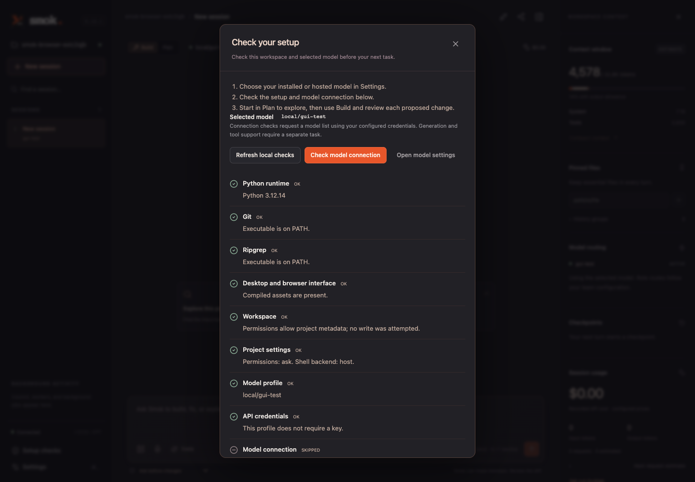

# Setup and local release checks

Smok provides first-run diagnostics and repeatable artifact checks, introduced in
0.9. The current source preview is 0.12.2. Start with the [quick start](../README.md#quick-start)
or the [documentation index](README.md). External signing, licensing, and package
distribution remain separate from publishing the source repository.



The same controls fit the [mobile layout](screenshots/setup-mobile.png), with the
connection and settings actions visible before scrolling through the results.

## First task

Open `Smok.app` and choose a writable project folder, or start the CLI from a source
checkout after `uv sync --locked --dev --extra lsp`.

1. Choose the model you actually have installed or can access. In the desktop app,
   use **Settings → Models**; add a hosted provider key in **Settings → API keys**.
2. Choose **Check setup** on the welcome screen or **Setup checks** in the sidebar.
   Resolve any errors, then choose **Check model connection** when ready.
3. Start in **Plan** with “Inspect this project and explain its entry points.” Switch
   to **Build** for changes and review the proposed diffs and commands before approval.

The selected model name must match your endpoint. The default profile is a starting
configuration, not evidence that a model is installed. Smok does not download models.
The CLI has the same diagnostic:

```sh
uv run smok --doctor -C /path/to/project --model ollama/YOUR_INSTALLED_MODEL
uv run smok --doctor --probe-model --model ollama/YOUR_INSTALLED_MODEL
uv run smok --doctor --json --model ollama/YOUR_INSTALLED_MODEL
```

`--doctor` reads runtime, PATH, frontend assets, workspace metadata permissions,
project settings, model configuration, and credential presence. It creates no session
or metadata, changes no saved settings or environment keys, and makes no network
request by default. Executables are checked for presence on PATH, not run. Filesystem
permission checks do not attempt a write. A successful local check does not prove the
model server is reachable.

`--probe-model` explicitly requests `GET <configured-base-url>/models` for an
OpenAI-compatible adapter. It uses configured credentials, a five-second total limit,
a 256 KB response limit, and no redirects or environment proxy. It sends no project
code or prompt and makes no generation request. Catalog availability does not verify
generation, vision, or tool-call support. Adapters without supported discovery and
endpoints without a model-list route report an unverified warning. An absent local
model is an error; a missing hosted entry is a warning because catalogs may be incomplete.

`--json` emits one report object with a schema version and per-check status, detail,
and suggested remedy. API key values, endpoint URLs, and HTTP response bodies are
omitted. Exit 0 means no check reported an error; warnings and skipped connection
checks remain visible. Exit 2 means a setup check failed; invalid command combinations
exit 1. Doctor cannot be combined with a task, runner, or session resume.

Common fixes:

| Finding | Next step |
| --- | --- |
| Git or ripgrep missing | Install the executable, make it available on PATH, then restart Smok. |
| Model not listed | Choose the exact installed model name and the correct endpoint in Settings. |
| Connection failed | Start the model server and check the configured URL and credentials. |
| Credentials missing | Set the profile's key environment variable or save its key in Settings. |
| Invalid project metadata | Correct the relevant `.smok` configuration; metadata symlinks are rejected. |
| Frontend assets missing | Reinstall the wheel or run `npm --prefix web run build` in a checkout. |
| Docker configured | Check its daemon and installed image separately; setup checks do not start Docker. |

The [GUI guide](gui.md) explains approvals, sessions, key storage, sharing, and
desktop prerequisites. An explicit small task is the next step for verifying actual
generation; hosted generation may incur API charges.

## Verify a local build

After running the Python and browser tests, build and inspect the distributions:

```sh
npm --prefix web run build
uv build
uv run python scripts/check_release.py
```

`check_release.py` verifies versions across Python, uv, npm, Cargo, and Tauri; compares
wheel/source-archive bytes with the checkout; requires current modules, interface
assets, setup guides, tests, graders, and reference repairs; and rejects private
metadata, environment files, eval runs, dependency/build caches, duplicate archive
entries, and links in the source archive. It exits nonzero on failure. CI runs this
after building the frontend and both Python distributions. Its SHA-256 output
identifies local artifacts, not a distribution signature or independent audit.

Build the native app using the [desktop build instructions](gui.md#development-and-checks),
then verify the current macOS bundle:

```sh
uv run python scripts/check_desktop.py
# Optional alternate app path and a saved report:
uv run python scripts/check_desktop.py --app /path/to/Smok.app --report /tmp/smok-native.json
```

The check verifies versions and the complete bundle signature, then launches the
bundled server in a disposable workspace. It checks authentication, offline diagnostics,
compiled asset parity, saved deadlines, shutdown, listener closure, and session-lock
release. It makes no generation request. It does not exercise native menu interactions
or certify notarization. Both scripts support `--report` for retaining evidence; the
archive checker also accepts `--dist`.

Current native validation covers Apple Silicon macOS. Developer ID signing,
hardened-runtime packaging, notarization, other platforms, provider billing/vision,
physical microphone behavior, naming, source/artwork licensing, and package distribution
remain the release work listed in the [roadmap](roadmap.md).
